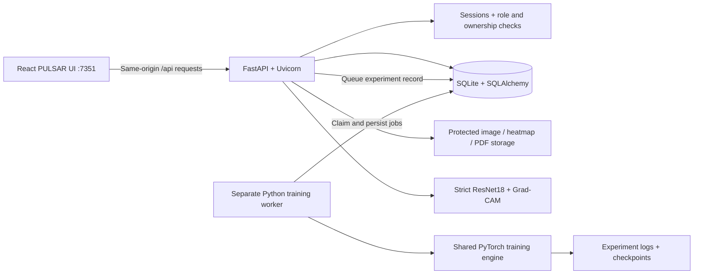
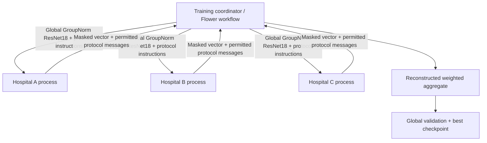

## Distributed Lung Cancer Diagnosis Using Privacy-Preserving Federated Learning

**Application:** PULSAR · **Document date:** 17 November 2026 · **Latest recorded accuracy upgrade:** 16 November 2026

PULSAR is a research application for four-class lung image classification, doctor-owned patient records, and federated learning experiments. This guide covers the existing application, its verified results, why each major technology was chosen, and how to run and reproduce the workflows.

**Research decision support, not a confirmed medical diagnosis.** The application classifies images into dataset labels. It has not established clinical diagnostic accuracy, patient-independent generalization, regulatory approval, or an independently audited production privacy guarantee.

| Key question | Verified answer |
| --- | --- |
| Which image classification architecture is active? | **ResNet18 only**, with a four-class output head |
| How many user roles exist? | **Two: Admin and Doctor** |
| Are patients users? | No. Patients are persistent records owned by authorized doctors |
| Which database is currently used? | **SQLite**, at `backend/research.db`, through SQLAlchemy |
| Is PostgreSQL used now? | No. Driver/configuration support exists, but a PostgreSQL deployment has not been tested |
| Which model serves image analysis? | `ml/saved_models/approved.pt`, version `centralized-transfer-224-20261116` |
| What is its measured test accuracy? | **92.79%: 103 correct classifications out of 111 test images** |
| Is federated training real? | Yes. Actual local ResNet18 optimization and aggregation run for Hospital A, B and C |
| Are these three deployed hospitals? | No. They are local research simulation clients |
| Is secure aggregation implemented? | Yes: Flower SecAgg+ with a cryptographic PRG adapter and separate client processes, within the stated threat model |
| Is differential privacy implemented? | Experimental Opacus DP-SGD with actual per-client accounting; limited to the documented update mechanism |
| Where is the frontend? | <http://127.0.0.1:7351> |
| Are metrics simulated for display? | No. Dashboard records and experiment charts use persisted API/database/artifact results |
| What accounts were provisioned locally? | One active Admin and five active Doctors at this snapshot; passwords are not included in this document |

## Accuracy upgrade at a glance

The previous and selected centralized ResNet18 models were evaluated against the same 111-image test boundary.

| Measurement | Previous model | Selected model |
| --- | ---: | ---: |
| Correct images | 84/111 | 103/111 |
| Test accuracy | 75.68% | **92.79%** |
| Test errors | 27 | 8 |
| Balanced accuracy | 74.52% | 93.96% |
| Macro F1 | 73.35% | 92.44% |

The gain was **17.12 percentage points** with **19 more correct predictions**. This represents a 70.37% reduction in errors on these particular images. The new run met the 85% research target through actual evaluation. PULSAR rounds the measured result to **92.8%** in its Overview card.

The selected checkpoint came from centralized transfer learning. The separate, one-round secure FedAvg verification measured **36.04%**. See [the full results and evaluation limits](#16-actual-evaluation-results).

## Contents

1. [Purpose and project boundaries](#1-purpose-and-project-boundaries)
2. [What has been completed](#2-what-has-been-completed)
3. [Architecture and data flow](#3-architecture-and-data-flow)
4. [Technology stack and reasons](#4-technology-stack-and-reasons)
5. [Repository structure and entry points](#5-repository-structure-and-entry-points)
6. [Database design and persistence](#6-database-design-and-persistence)
7. [Roles, accounts and authorization](#7-roles-accounts-and-authorization)
8. [Patient records and doctor workflows](#8-patient-records-and-doctor-workflows)
9. [Image upload, inference and Grad-CAM](#9-image-upload-inference-and-grad-cam)
10. [Models, algorithms and optimizers](#10-models-algorithms-and-optimizers)
11. [Dataset audit and repaired splits](#11-dataset-audit-and-repaired-splits)
12. [Training and checkpoint contracts](#12-training-and-checkpoint-contracts)
13. [Federated learning](#13-federated-learning)
14. [Secure aggregation](#14-secure-aggregation)
15. [Differential privacy](#15-differential-privacy)
16. [Actual evaluation results](#16-actual-evaluation-results)
17. [Frontend pages and visual design](#17-frontend-pages-and-visual-design)
18. [Backend API reference](#18-backend-api-reference)
19. [PDF reports](#19-pdf-reports)
20. [Security controls and limits](#20-security-controls-and-limits)
21. [Installation and startup](#21-installation-and-startup)
22. [Configuration reference](#22-configuration-reference)
23. [Training, evaluation and model selection commands](#23-training-evaluation-and-model-selection-commands)
24. [Testing and verified evidence](#24-testing-and-verified-evidence)
25. [Troubleshooting and operation](#25-troubleshooting-and-operation)
26. [Original problems and implemented repairs](#26-original-problems-and-implemented-repairs)
27. [Remaining work and accuracy improvement](#27-remaining-work-and-accuracy-improvement)
28. [Glossary and presentation questions](#28-glossary-and-presentation-questions)
29. [Evidence files and references](#29-evidence-files-and-references)

## 1. Purpose and project boundaries

The project connects medical image classification, doctor-managed patient records, explainable model output, and experiments in decentralized training. Doctors can register patients, record clinical history, upload images, request ResNet18 analysis, review Grad-CAM, add observations and generate reports. Admins manage doctors and inspect aggregate application statistics, experiments, model comparisons and privacy evidence.

The research question is how centralized and federated ResNet18 training behave on the same repaired dataset, and what happens when update protection and experimental DP-SGD are enabled. Federated learning keeps raw samples out of update messages. Secure aggregation limits what the protocol coordinator can read from individual contributions. DP-SGD separately clips and noises gradients and accounts for a specified release mechanism.

These are distinct properties. Training without copying images into an update message does not, by itself, establish privacy. An encrypted aggregate does not establish differential privacy. A high classification probability is not a validated clinical risk estimate.

The application has no patient login, nurse role, receptionist role, automatic treatment recommendation, cancer staging model, tabular clinical-risk fusion, or alternative image-classifier fallback. Doctor-entered clinical information is stored for record keeping and review; it is not secretly combined with image probabilities to create a synthetic diagnosis score.

## 2. What has been completed

An arbitrary completion percentage would hide the distinction between working local features and unvalidated deployment/research claims. The status below describes concrete functionality.

| Area | Implemented and verified | Practical boundary |
| --- | --- | --- |
| Existing repository upgrade | Existing frontend/backend/ML directories extended; stale entry points retired | Historical files remain for traceability |
| ResNet18 classifier | Canonical factory, four-class head, strict metadata loading | Selected model is a short research run |
| Dataset validation | Byte/pixel hashes, duplicate grouping, reproducible manifests | Patient IDs and near-duplicate certainty are unavailable |
| Centralized training | Real optimization, validation, early stopping, best checkpoint, final test | Longer/external validation remains research work |
| Two-role authentication | Login/logout, hashed passwords, sessions, role/status enforcement | No enterprise identity integration |
| Doctor management | Create, update, activate/deactivate, password reset | No public account registration |
| Patient management | Create/edit/search/filter/sort/page, histories, visits, follow-ups | Ownership model is one doctor per patient |
| Protected image upload | PNG/JPEG validation, re-encoding, authorized retrieval | No DICOM workflow or modality certification |
| Analysis | Persisted class probabilities, model version/hash and Grad-CAM | No calibrated clinical risk or tumor localization claim |
| PDF reports | Protected generation/download, images, results and doctor review | Snapshot PDFs do not change after later review edits |
| FedAvg and FedProx | Three clients, real local training, reproducible non-IID partitions | Local simulation, not independently hosted hospitals |
| Experiment tracking | SQL queue, worker, round metrics, results and failures | Documented operation uses one worker |
| Secure aggregation | Four-stage Flower SecAgg+, process boundary, dropout/tamper tests | Semi-honest coordinator, no client collusion, shared host excluded |
| DP-SGD | Opacus per-sample processing and cumulative RDP accounting | Experimental example-level mechanism, research RNG |
| Admin/Doctor interfaces | API-connected responsive PULSAR workspaces | System settings screen reports readiness/configuration; it is not a deployment control plane |
| Testing | 42 distinct backend tests; six browser tests; build/lint pass | Evidence is local, not a certification |
| PostgreSQL deployment | Optional driver and URL path | Not validated against a running PostgreSQL service |
| Clinical deployment | Explicit research disclaimer and limitations | Clinical approval and real-world validation are not established |

The October snapshot contained seven completed experiments and one invalidated historical experiment. The November fine-tuning run adds one completed experiment. Historical duplicate verification runs remain for traceability and are not independent scientific replications. Accounts consist of one Admin and five Doctors. These are a snapshot of this workspace, not hardcoded defaults or limits on how many doctors can be created.

## 3. Architecture and data flow

### 3.1 Application architecture



The browser does not connect directly to the database or access model files. Vite proxies `/api` to the local API. The backend checks identity and permissions before reading patient data or serving protected files. Training runs in a separate worker so a long experiment does not occupy an API request handler.

### 3.2 Secure federated round



Local model arrays are returned to Flower's client modifier inside each client process. The modifier masks them and clears their array records before the reply crosses the process boundary. The coordinator's strategy receives the recovered aggregate rather than three unmasked client models.

All clients still share one machine and filesystem. This architecture verifies the protocol/message boundary; it does not protect data from an administrator controlling that machine.

## 4. Technology stack and reasons

Versions below are the inspected environment snapshot. Python requirements pin versions; frontend `package.json` ranges and `package-lock.json` serve different purposes. `npm ci` reproduces the lockfile rather than freely selecting newer versions.

| Layer/tool | Version or implementation | Why it is used here |
| --- | --- | --- |
| Python | 3.14.0 in the inspected environment | Shared backend, training, evaluation and worker language |
| JavaScript / JSX | React application source | Browser UI and reusable components |
| HTML / CSS | Native markup and custom CSS | Forms, responsive grids, visual system and accessibility |
| React | Installed 19.2.4 | Component/state-based Admin and Doctor workspaces |
| Vite | Installed 7.3.7 | Development server, React build and `/api` proxy |
| Node.js | 24.13.0 inspected | Runs Vite, npm and browser-test tooling |
| npm | 10.8.2 inspected | Frontend dependency and script execution |
| Framer Motion | 14.4.0 | UI transitions while respecting reduced-motion preferences |
| Lucide React | 1.60.0 | Consistent interface icons |
| FastAPI | 0.138.2 | Validated Python APIs, dependency-based authorization and OpenAPI documentation |
| Uvicorn | 0.49.0 pinned | ASGI server for FastAPI |
| Pydantic | 2.12.5 pinned | Validated requests and a shared CLI/API training configuration contract |
| python-multipart | 0.0.22 pinned | File-upload form parsing |
| SQLAlchemy | 2.0.55 | ORM, parameterized SQL construction and database sessions |
| Alembic | 1.20.0 | Versioned database schema migrations |
| SQLite | Python environment's SQLite engine | Persistent local relational database without a separate server |
| PostgreSQL / psycopg | Optional `psycopg[binary]>=3.2,<4` | A future server-database deployment option; not the active database |
| PyTorch | 2.12.0+cpu | Autograd, model training, tensors and inference |
| torchvision | 0.27.0+cpu | Canonical ResNet18 and image preprocessing utilities |
| NumPy | 2.4.2 pinned | Array operations, partition sampling and protocol tensor handling |
| Pillow | 12.1.1 pinned | Image decoding, EXIF handling, validation and PNG output |
| scikit-learn | 1.8.0 pinned | Accuracy, balanced metrics, confusion matrices and ROC-AUC |
| Flower | 1.40.0 | Weighted FedAvg strategy and actual SecAgg+ workflow/client modifier |
| Opacus | 1.6.0 | Per-sample gradients, clipping, Gaussian noise and RDP accountant |
| cryptography | 50.0.2 | Cryptographic primitives, including the HKDF/ChaCha20 mask expansion adapter |
| Python `hashlib` / `secrets` / `hmac` | Standard library | Password hashing, content hashes, random tokens and constant-time comparisons |
| ReportLab | 4.5.1 pinned | Server-generated PDF reports |
| pytest | 9.0.2 pinned | Backend, ML, protocol and worker tests |
| Playwright | 1.64.1 installed | Real browser workflows using installed Microsoft Edge |
| ESLint | Frontend development dependency | JavaScript/React lint checks |
| httpx / httpx2 | 0.28.1 / 2.15.1 pinned | HTTP/testing support, including the compatible Starlette TestClient path |
| pypdf / PyMuPDF | 6.21.1 / 1.28.2 pinned | PDF extraction and rendering checks in development |

Charts are implemented in the React application using its own markup/styles; a separate chart service is not required. Hash routing is implemented in the app; React Router is not an installed dependency. Authentication uses revocable opaque sessions, not JWTs stored in localStorage. The training queue uses SQL records and a Python worker, not Redis/Celery.

## 5. Repository structure and entry points

```text
DFL-CP/
  DFL FINAL-CP README.md       This detailed explanation
  README.md                   Shorter setup and operational guide
  START.cmd                   Windows command-prompt launcher
  start.ps1                   PowerShell launcher
  .env.example                Environment-variable reference
  pytest.ini                  Backend test discovery and known warning policy
  dataset_audit_report.json   Actual dataset audit output
  upgrade-checklist.md        Initial implementation checklist
  backend/
    main.py                   FastAPI app factory and /api route handlers
    api_schemas.py            Request validation models
    security.py               Passwords, sessions, CSRF and role dependencies
    database.py               Engine/session creation and SQLite configuration
    models.py                 Persistent application entities
    bootstrap.py              First Admin CLI and hospital-record initialization
    dev.py                    API/worker/Vite process supervisor
    worker.py                 Persistent experiment queue processor
    import_experiment.py      Import validated CLI artifacts into SQL
    invalidate_experiment.py  Explicitly invalidate unsuitable experiment evidence
    storage.py                Image validation and protected path resolution
    reports.py                PDF generation
    migrations/               Alembic revisions
    research.db               Active local database
    storage/                  Protected images, heatmaps, PDFs and runtime logs
    DataSet/                  Existing source image dataset
    requirements*.txt         Runtime, privacy, development and optional DB packages
  frontend/
    index.html                HTML entry and application metadata
    src/main.jsx              React mount point
    src/App.jsx               Role-aware pages and workflow components
    src/index.css             PULSAR design and responsive styles
    src/api.js                Fetch wrapper, cookies, CSRF and API errors
    src/useResource.js        Loading/error/retry/polling lifecycle
    public/pulsar.svg          Application identity asset
    vite.config.js            Port 7351 and API proxy
    e2e/                      Browser workflow tests
    playwright.config.js      Isolated API/UI test servers
    package.json              Frontend scripts and dependency ranges
    package-lock.json         Locked frontend dependency resolution
  ml/
    models/resnet18.py        The only active classifier factory and GN variant
    checkpoints.py            Strict checkpoint and preprocessing contract
    dataset.py                Audit, grouping, splits and manifest validation
    data/manifest.json        Approved reproducible split manifest
    engine.py                 Shared training and evaluation engine
    train.py                  Supported centralized/FedAvg/FedProx CLI
    evaluate.py               Held-out evaluation with manifest checks
    approve.py                Explicit inference checkpoint selection
    federated.py              Partitioning, plaintext Flower FedAvg and FedProx loss
    secure_aggregation.py     SecAgg+ workflow/transport and cryptographic PRG adapter
    secure_client.py          Hospital-local training callback
    privacy.py                Opacus integration and privacy capabilities
    metrics.py                Measured classification metrics
    gradcam.py                ResNet18 layer4 Grad-CAM
    inference/image_predictor.py  Strict prediction service
    saved_models/             Selected checkpoint and retained legacy artifacts
    outputs/experiments/      Configurations, round logs, checkpoints and results
  tests/                      Isolated backend, ML, privacy and worker tests
  docs/
    IMPLEMENTATION.md         Staged work, commands, failures/fixes and evidence
    SECURE_AGGREGATION.md     Detailed protocol, threat model and tests
    verification-summary.json Structured verification snapshot
    approved-model-test.json  Selected inference model's held-out metrics
    checkpoint-audit.json     Checkpoint compatibility audit
    source-inventory.json     Original repository audit
    screens/                  Browser and PDF QA artifacts
    legacy/                   Archived non-runtime source/history
```

Historical Python filenames remain as retirement notices or supported aliases in some locations. Use `ml.train`, `ml.evaluate`, `backend.main:app` and `backend.worker` as documented entry points. File presence does not mean a legacy pipeline is active. `.venv` and other old environment folders are not the documented runtime; use `backend/venv`.

## 6. Database design and persistence

### 6.1 Which database is used, and why?

The active database is **SQLite**, a relational database stored in `backend/research.db`. SQLite suits this local research installation because it persists across restarts, supports the project's relationships and transactions, and requires no separately configured database server.

SQLAlchemy provides the application data layer. It builds queries, maps entities and manages sessions. It is not a database engine. Alembic records schema changes. PostgreSQL is a supported configuration direction, not a database that was silently installed or verified here.

The SQLite connection enables foreign-key checks and WAL mode. WAL helps the local API/worker read/write pattern, but does not turn SQLite into a production multi-hospital database. The configured connection timeout is 30 seconds and cross-thread access is enabled for FastAPI's use. The documented operational model uses one training worker.

The inspected database contains **16 application tables plus `alembic_version`**:

| Table | Main data and purpose |
| --- | --- |
| `users` | Unique email, name, password hash, role, active flag, creation timestamp |
| `doctor_profiles` | Doctor specialty, hospital affiliation and registration text; one profile per doctor user |
| `sessions` | Hashed opaque session token, user reference, CSRF token and expiry |
| `login_attempts` | Hashed account/client key, failure count and rate-limit window |
| `setup_state` | One-time initial Admin enrollment lock |
| `patients` | Doctor ownership, generated ID, demographics, clinical fields and follow-up |
| `clinical_histories` | Historical clinical record snapshots and author references |
| `visits` | Patient visit notes, follow-up date and timestamp |
| `medical_images` | Patient reference, protected storage key, original-upload hash and dimensions |
| `analyses` | Image/patient references, model-output JSON, heatmap key and doctor review |
| `reports` | Patient/analysis references, protected PDF key and creation timestamp |
| `federated_clients` | Hospital A/B/C simulation identities and readiness status |
| `experiments` | Algorithm, configuration JSON, lifecycle status, results/error and timestamps |
| `round_metrics` | Experiment/round reference and measured per-round JSON; round uniqueness enforced |
| `privacy_metrics` | Per-experiment, round and client accountant metrics |
| `audit_logs` | Actor/action/resource reference and timestamp |
| `alembic_version` | Migration revision tracking; infrastructure metadata |

JSON columns hold structured outputs/configuration and do not mean the application uses a document database. SQL rows keep associations between users, patients, images, analyses and reports.

### 6.2 Main relationships

- A Doctor user owns multiple patients; each patient has one `doctor_id` in this implementation.
- A patient can have multiple histories, visits, medical images, analyses and reports.
- An analysis points to one image and one patient.
- A report points to one analysis and its patient.
- An experiment has multiple uniquely numbered rounds and optional per-client privacy entries.
- A user can have sessions; deactivation/password changes revoke relevant sessions.

Most IDs are random UUID hex strings. Patient identifiers use `PT-` plus 12 uppercase random hexadecimal characters. Timestamps are stored as UTC ISO-formatted strings; birth/follow-up dates are calendar dates. Database primary/foreign/unique/check constraints complement API validation.

### 6.3 Where files live

Image/PDF binaries are stored in protected filesystem storage, not as database BLOBs. SQL rows store random references and metadata. This keeps image handling separate from relational queries. The directory is not publicly mounted as a static URL. Authorized endpoints resolve references, verify ownership and return files.

The original upload hash is computed before re-encoding; the stored PNG may therefore have a different file hash. Model files and experiment artifacts live separately under `ml/`. A complete backup needs the database, protected storage and relevant model/manifest artifacts together. Copying only the database loses referenced binaries.

Storage and SQLite are **not encrypted at rest by this application**. Active WAL databases should be backed up using a consistent SQLite backup or after stopping writes; do not assume copying only `research.db` during activity captures all committed data. Retention, backup restore drills and at-rest encryption remain deployment responsibilities.

### 6.4 Migrations

`0001_research.py` establishes the research schema; `0002_setup_state.py` adds the one-time setup lock with compatibility checks for existing installations. The launcher applies Alembic migrations before launching API/worker processes. ORM initialization also ensures tables/hospital rows exist; it does not replace migration discipline for later schema changes.

## 7. Roles, accounts and authorization

### 7.1 Exactly two roles

| Capability | Admin | Doctor |
| --- | --- | --- |
| Log in/out | Yes | Yes |
| Manage doctor accounts/status | Yes | No |
| View aggregate application counts | Yes | Own-patient workspace counts |
| Queue/read training experiments | Yes | No |
| View privacy/comparison/audit/system screens | Yes | No |
| Create and edit patients | No | Owned patients |
| Read identifiable patient records | No | Owned patients |
| Upload/view patient images and heatmaps | No | Owned patients |
| Run/review AI analysis | No | Owned patients |
| Generate/download patient reports | No | Owned patients |
| Update own doctor profile | No Doctor-profile endpoint | Yes |

The Admin role does not inherit Doctor permissions. Knowing a patient ID does not authorize access. SQL queries check both patient ID and authenticated doctor ID. Cross-doctor lookups return a not-found response, limiting identifier disclosure. Frontend navigation guards are an additional usability layer; backend checks remain authoritative.

### 7.2 Account lifecycle

The local launcher can enable first-Admin browser setup only when the database has no users and enrollment has not completed. The request must come through loopback, the setup feature must be enabled, and a server setup token must match. A fixed primary-key record prevents repeated/concurrent initial enrollment. Secure-cookie deployment mode disables this local enrollment path.

Alternatively, an operator can create an Admin with the interactive `backend.bootstrap` command. This is an operator action, not public registration. Admin creates Doctors with a name, email and password; profile details are optional. Password creation/reset requires 12–128 characters. Email is normalized to lowercase. Doctor accounts may be activated/deactivated, and Admin can reset their passwords.

One Admin and five Doctors were explicitly created for this workspace. Their credentials were provided privately in chat rather than embedded into source or documentation. New installations do not inherit these accounts unless they also use this existing database. There is no hardcoded universal login password.

## 8. Patient records and doctor workflows

### 8.1 Patient fields

| Field | Validation/behavior |
| --- | --- |
| Patient ID | Automatically generated |
| Full name | Required, 2–160 characters |
| Date of birth | Required; between 1900 and the current date |
| Sex | Female, Male, Other, Not specified |
| Contact | Optional, maximum 200 characters |
| Smoking status | Never, Former, Current, Unknown |
| Smoking history | Optional, maximum 4,000 characters |
| Family history | Optional, maximum 4,000 characters |
| Respiratory conditions | Optional, maximum 4,000 characters |
| Symptoms | Optional, maximum 4,000 characters |
| Relevant medical history | Optional, maximum 8,000 characters |
| Allergies | Optional, maximum 4,000 characters |
| Current medications | Optional, maximum 4,000 characters |
| Doctor notes | Optional, maximum 8,000 characters |
| Follow-up date | Optional calendar date |

Optional fields need not be filled simply to run image classification. The backend validates edits by merging a patch with the persisted record and checking the complete result. Clinical history snapshots preserve the recorded history; creation stores the initial snapshot and edits record the previous values.

### 8.2 Directory and patient profile

The directory supports name/ID search, smoking-status filtering, sorting by name/update/follow-up, and pagination. Default page size is 12; the API allows 1–100 items per page. Search wildcard characters are escaped. Name/follow-up sort ascending; updated records sort newest first, with an ID tie-breaker. Sorting resets frontend pagination.

Patient tabs are Overview, Clinical History, Medical Images, AI Analysis, Visit Timeline and Reports. Records use database-backed API calls, with empty/loading/error/retry states. Visit notes are required, up to 8,000 characters. A visit's follow-up date updates the patient's follow-up field. Follow-up screens organize recorded dates; they do not send automated reminders or messages.

### 8.3 Complete doctor workflow

1. Log in as an active Doctor.
2. Register a patient or open an owned patient record.
3. Add relevant history and notes.
4. Upload a valid PNG/JPEG image.
5. Select the uploaded image and request analysis.
6. Review original image, Grad-CAM, predicted class, all probabilities and model metadata.
7. Add observations and doctor-entered follow-up recommendations.
8. Save the review or generate a report; the UI saves current review edits before creating the PDF.
9. Return to analysis history, visit timeline or the report list later.

Changing the selected image changes which analysis is displayed. A newly uploaded image does not display another image's previous prediction or heatmap.

## 9. Image upload, inference and Grad-CAM

### 9.1 Upload checks

The backend verifies ownership before upload. It accepts PNG and JPEG only; extension, declared MIME type and decoded image format must agree. Maximum upload size is **10 MiB**, maximum decoded area is **16,000,000 pixels**, and each dimension must be at least 32 pixels. Corrupt images and decompression-bomb conditions are rejected. The input is decoded, EXIF orientation is applied, converted to RGB and written as a clean PNG with a random storage key.

The upload endpoint does not accept DICOM or promise that a valid PNG/JPEG contains a medically appropriate scan. Dataset scanning supports some additional raster extensions; that broader audit support does not expand the API upload contract.

### 9.2 Inference pipeline

The configured checkpoint is loaded through `ml.checkpoints.load_checkpoint`. It must contain the ResNet18 architecture name, verified ordered labels, exact class-to-index mapping, normalization variant, preprocessing, model version and manifest provenance. Parameter keys/head sizes must load strictly. Missing/incompatible checkpoints cause an explicit analysis error, normally HTTP 503, and no fabricated analysis record is saved.

Preprocessing applies the recorded square image size, bilinear resizing, RGB conversion, tensor conversion and ImageNet-style normalization: mean `[0.485, 0.456, 0.406]`, standard deviation `[0.229, 0.224, 0.225]`. The currently selected checkpoint uses **64×64** input. Training configuration also supports 128 and 224 pixels. There is no independent preprocessing guess at inference time.

The model produces four logits. Softmax converts them to a probability distribution, and argmax selects the highest-scoring class. These numbers are model probabilities, not externally calibrated disease probabilities. The record includes architecture, version, model SHA-256, metadata, timing and the research notice. Training completion does not automatically replace the selected inference model.

### 9.3 Grad-CAM explained

Grad-CAM uses gradients of a class score with respect to the final convolutional feature map. This implementation hooks **ResNet18 `layer4`**, averages gradients spatially to obtain channel weights, combines the feature maps, applies ReLU, resizes/normalizes the map and overlays it on the original image. Hooks and gradients are cleaned up after use.

The default explanation is for the predicted class. It can indicate regions associated with the model's output. It is not an additional classifier, a segmentation mask, proof of causation, or validated tumor localization.

## 10. Models, algorithms and optimizers

### 10.1 ResNet18 is the only classifier

ResNet18 is a residual convolutional neural network. Skip connections add an earlier activation to a later transformation, helping optimization of stacked layers. The canonical torchvision model has its final fully connected layer replaced with `Linear(512, 4)` for this dataset.

The four-class implementation has **11,178,564 trainable parameters**. Its name convention refers to the architecture's standard 18-layer depth; it is not a count of every Python module, normalization layer or shortcut operation.

ResNet18 is used because the project explicitly requires one consistent architecture, torchvision supplies a standard implementation, it supports transfer learning and Grad-CAM, and it can be executed on the inspected CPU environment. Using the same factory avoids architecture/head mismatches across centralized training, hospital clients and inference. This is an implementation choice, not evidence that ResNet18 is clinically best for all lung imaging.

### 10.2 BatchNorm and GroupNorm variants

| Variant | Used for | Why |
| --- | --- | --- |
| ResNet18 + BatchNorm | Selected inference model and ordinary non-DP plaintext runs | Standard torchvision normalization path |
| ResNet18 + GroupNorm | DP-SGD and secure aggregation runs | DP-compatible per-sample processing; avoids BatchNorm integer counters in the secure floating quantizer |

The GroupNorm variant preserves ResNet18 blocks and the four-class head. BatchNorm layers are replaced with GroupNorm; non-inplace ReLU/residual operations support gradient-hook compatibility. The trainable parameter count remains 11,178,564. The variant is recorded in metadata and reconstructed by the strict loader.

These normalization variants can behave differently. Comparing their accuracy does not isolate the effect of DP noise or encryption. The secure verification run did not replace the BatchNorm inference model.

### 10.3 Approaches are not separate architecture families

| Name | What it actually is |
| --- | --- |
| Centralized ResNet18 | One ResNet18 trained on the centralized training manifest |
| Federated ResNet18 / FedAvg | The same architecture trained locally and sample-weight averaged |
| Federated ResNet18 / FedProx | The same architecture with a proximal regularization term during local training |
| Secure aggregation | A protocol protecting individual update contributions, not a classifier |
| DP-SGD | A private optimization mechanism, not a classifier |
| Grad-CAM | An explanation method, not a classifier |
| SGD and Adam | Optimizers adjusting model parameters, not architectures |

No MobileNet/MobileNetV2 or other image-classification architecture is active. Old binary files may remain under `ml/saved_models`, but are not selected or used as fallbacks. Historical tabular/combined predictors are retired; stored smoking/symptom fields do not feed an active second diagnosis model.

### 10.4 SGD, Adam and loss

**SGD** means Stochastic Gradient Descent. It updates parameters in the direction that reduces loss, using gradients estimated from batches. The learning rate controls step size. This implementation's SGD path does not add an undocumented momentum or learning-rate scheduler.

**Adam** adapts updates using estimates of gradient moments. It is the default optimizer and a candidate for fine-tuning; it is not guaranteed to outperform SGD. Client optimizers are created for local training calls; Adam optimizer moment state is not federated or retained as persistent client state across rounds in the current engine.

Cross-entropy measures disagreement between logits and the true class index. The current baseline does not silently introduce class-weighted loss, synthetic oversampling or unverified clinical features. Class distributions and balanced metrics make imbalance visible. FedProx adds the separate proximal term described below.

## 11. Dataset audit and repaired splits

### 11.1 What was found

The original repository audit and manifest referenced a missing drive and inconsistent labels. Direct inspection of the actual dataset established:

| Audit item | Actual finding |
| --- | --- |
| Source image files | 1,565 |
| Unique file-byte SHA-256 hashes | 838 |
| Unique decoded image contents | 727 |
| Original test images with pixel-identical training copies | All 111 |
| Patient/study identifiers available in source metadata | None found |
| Current active manifest | 727 unique decoded images |
| Split overlap after repair | No exact file/pixel/group overlap across active splits |

Some duplicates had different encoded file bytes but identical decoded pixels. File SHA-256 alone missed that issue. The repaired audit hashes both file bytes and oriented RGB pixel data plus dimensions. It groups byte duplicates, pixel duplicates and any supplied patient/study IDs transitively.

Original test groups remain reserved for testing. Duplicate copies are excluded from the active manifest rather than deleted from disk. Training uses the manifest; it does not trust the physical folder names as independent clean splits. Old models potentially exposed to the original test images cannot substantiate current held-out performance.

### 11.2 Actual class distribution

| Verified class/index | Training | Validation | Test | Total |
| --- | ---: | ---: | ---: | ---: |
| 0 — Adenocarcinoma | 151 | 33 | 33 | 217 |
| 1 — Large Cell Carcinoma | 130 | 28 | 29 | 187 |
| 2 — No Cancer | 46 | 10 | 10 | 66 |
| 3 — Squamous Cell Carcinoma | 179 | 39 | 39 | 257 |
| **Total** | **506** | **110** | **111** | **727** |

Requested ratios are configurable at 70/15/15. Actual counts are approximately 69.60%/15.13%/15.27% because grouping and preserved test boundaries take priority over exact percentages. Class names are dataset labels; they do not certify the modality, source population or clinical correctness of arbitrary future uploads.

### 11.3 Reproducibility and limitations

The manifest records paths, labels, hashes, group IDs, optional patient/study IDs and splits. Fixed seeds and source files reproduce it. The loader checks split/group overlap and source file hashes before training. Supplying a metadata CSV enables patient/study grouping, but missing IDs remain visible rather than being fabricated.

The validation scope is **provisional image-group splitting; patient independence unverified**. Exact duplicate hashing cannot exclude all near duplicates, related slices, augmentation variants or unidentified patients across sources. Dataset provenance, permission/licensing and patient identity should be verified before wider use. Patient records created in the application are not automatically labelled training data and are not silently added to this manifest.

## 12. Training and checkpoint contracts

### 12.1 Shared configuration

`ml/config.py` validates CLI, API and worker settings, rejects extra fields and disallows nonfinite numbers.

| Setting | Supported/default API configuration |
| --- | --- |
| Algorithm | `centralized`, `fedavg`, `fedprox`; API default `fedavg` |
| Rounds | 1–100; API default 3; CLI default 10 |
| Local epochs | 1–20; default 1 |
| Batch size | 2–128 configured; loader may reduce to a smaller client's size |
| Image size | 64, 128 or 224; default 224 |
| Learning rate | Greater than 0, at most 0.1; default 0.001 |
| Optimizer | Adam or SGD; default Adam |
| Seed | 0–2,147,483,647; default 42 |
| Dirichlet alpha | Greater than 0, at most 100; default 0.5 |
| FedProx mu | 0–10; default 0.01 |
| Early-stop patience | 1–100; default 3 rounds without macro-F1 improvement |
| Pretrained initialization | Optional; default false |
| Secure aggregation | Optional; valid only for FedAvg/FedProx |
| CPU threads | CLI/worker configuration 1–64; default 4 |

The UI exposes the main experiment settings and privacy options. Pretrained initialization and patience are CLI settings. The November 224-pixel centralized run used both. The longer secure federated recipe in Section 23 is a future experiment.

### 12.2 Training lifecycle

The engine validates configuration and the manifest, seeds reproducible training components, creates ResNet18, applies the required normalization variant, and builds train/validation loaders. Each round performs actual optimizer steps, evaluates validation data and logs the result. The best checkpoint is chosen by **validation macro F1**. Training stops at the configured round limit or early-stop patience. The held-out test is evaluated after checkpoint selection.

For centralized training, `rounds` acts as outer training iterations/epochs when `local_epochs=1`; if `local_epochs` is increased, each outer iteration performs that many training epochs. Federated rounds each execute configured local epochs at participating clients.

Python, NumPy and PyTorch initialization/loaders are seeded; PyTorch deterministic algorithms are requested with warning behavior. These controls do not establish bit-identical results across all devices/library versions. DP randomness and secure mask secrets are deliberately separate from public reproducibility seeds.

### 12.3 Experiment artifacts

| Artifact | Contents |
| --- | --- |
| `config.json` | Validated configuration, public client distributions/counts and metadata |
| `rounds.jsonl` | One structured record per completed round |
| `best.pt` | Strict ResNet18 state plus metadata for the best validation round |
| `results.json` | Final held-out metrics, timing, communication scope and privacy/protocol information |
| `accountants.pt` | Raw accountant state for non-secure DP runs; private artifact, not public dashboard data |

Secure DP accountant state remains inside persistent hospital processes and is not written to a coordinator `accountants.pt`. Interrupted secure runs cannot be silently resumed with reset privacy accounting.

Output directories must be fresh; the trainer refuses to overwrite previous evidence. CLI artifacts become dashboard records only after import. Jobs launched by the Admin form are persisted by the worker automatically.

### 12.4 Strict checkpoint loading and explicit selection

Checkpoint schema version 1 contains `state_dict` and metadata. Required fields include `ResNet18`, ordered classes, exact mapping, preprocessing, normalization, version, manifest SHA-256 and validation scope. New checkpoints also record algorithm, configuration and best round. Inference uses strict parameter loading and `torch.load(..., weights_only=True)`.

`ml.approve` checks class/manifest compatibility, copies a chosen checkpoint to the selected path and writes its metadata sidecar. The word **approved** means selected for this research application's inference configuration. It is not a medical/regulatory approval. Replacing a selected model is an explicit operator action, not an automatic consequence of finishing training.

## 13. Federated learning

### 13.1 Three clients and non-IID data

The clients are Hospital A, Hospital B and Hospital C. Fixed-seed Dirichlet sampling creates label-imbalanced client preferences from **training groups only**. Patient IDs are used for grouping where available; otherwise content groups are used. Related group members are not split between clients. At least three independent groups are required, and the first assignments ensure each client receives data.

For the recorded full-data seed/alpha configuration, public training counts are **198 / 233 / 75**. Different seeds or alpha values can produce different distributions. Smaller alpha is a way to test more uneven label preferences, not a guarantee that a particular partition is clinically representative. Raw training images and patient records are not included in update payloads. The local coordinator can still access shared-host data; the simulation is not a remote-hospital privacy boundary.

### 13.2 FedAvg

The coordinator initializes a global ResNet18, sends its parameters, clients train locally, and updates are weighted by local training sample count:

```text
w_next = sum(n_k * w_k) / sum(n_k)
```

`n_k` is the client's training sample count and `w_k` its locally trained parameters. The plaintext baseline uses Flower's weighted FedAvg strategy for floating tensors and maximum BatchNorm counters for non-floating state. It requires all three updates and rejects malformed keys, shapes, dtypes and nonfinite tensors.

The secure path instead uses SecAgg+ fixed-point reconstruction. It does not call the plaintext aggregation function as a fallback. Secure aggregation protects contributions under its own threat model while approximating the same weighted model average.

### 13.3 FedProx

FedProx adds a penalty for moving too far from the round's global parameters:

```text
L_FedProx = L_local + (mu / 2) * sum((w - w_global)^2)
```

This is intended to study client drift under heterogeneous data. `mu=0` removes the proximal term. Higher mu is not automatically better; it can restrict learning too much. Ordinary training adds the term to the loss before backpropagation. DP FedProx adds its deterministic proximal gradient after Opacus clips/noises the data gradient and before the underlying optimizer step.

### 13.4 Tracking and jobs

Admin submits a validated experiment; SQL stores it as `queued`. The separate worker atomically claims it as `running`, records completed rounds/checkpoints/results, and sets `completed` or `failed`. Invalidated historical evidence is explicitly marked `invalidated`. Failures include an error rather than success-shaped placeholder output. The API rejects a new queue request if another experiment is queued/running in the documented deployment.

Per-round records include client metrics/counts, withheld-data flags, validation loss/accuracy/F1, duration, communication size and secure protocol evidence where enabled. Logical tensor bytes are used for plaintext simulations. Serialized protocol message bytes are used for secure simulations. Neither is a measured multi-host network throughput benchmark.

## 14. Secure aggregation

Full implementation details and the test policy are in [docs/SECURE_AGGREGATION.md](docs/SECURE_AGGREGATION.md).

### 14.1 Why it is used

Plain federated learning sends individual model updates to a coordinator. Those updates can disclose information. Secure aggregation lets the protocol recover a combined update while masking individual contributions. It is a different protection from HTTPS and from adding DP noise.

### 14.2 Implemented protocol

The implementation uses pinned Flower **1.40.0** `SecAggPlusWorkflow` and `secaggplus_mod`, executing four stages: setup, share keys, collect masked vectors and unmask. Each hospital runs in a separately spawned Python process. Private keys, local model arrays and DP accountant state stay inside that process. The transport exchanges serialized Flower protobuf messages over local pipes; it is not a Ray or SuperLink/SuperNode network deployment.

Flower's cryptographic operations establish keys, encrypt shares and reconstruct the necessary masks. The application validates messages and aborts failed rounds. No raw client model is substituted into a failed secure run.

### 14.3 Cryptographic mask expansion

Inspection of the pinned dependency found that its default mask PRG folds its seed into 32 bits and uses NumPy RandomState. That default is not used. A versioned adapter derives a 256-bit key from the full secret using HKDF-SHA256, with protocol/array/shape domain separation, and expands masks with `cryptography` ChaCha20. It is installed explicitly in both client and server protocol modules without editing installed package files.

All participants must use this adapter. The protocol label is **Flower SecAgg+ / ChaCha20-HKDF v1**. It is a documented variant, not compatible with an unmodified default mask generator. Tests check full-seed dependence, deterministic expansion, separate array domains and fresh masks across rounds. These are implementation checks, not an independent cryptographic proof/audit.

### 14.4 Participants, dropout and quantization

| Item | Implemented setting |
| --- | --- |
| Registered/selected hospitals | Exactly 3 |
| Initial key establishment | All 3 required |
| Minimum masked contributors | 2 |
| Reconstruction threshold | 2 shares out of 3 |
| One client drops after key exchange, before upload | Recover weighted aggregate of uploaded contributions |
| One drops after upload, before reconstruction reply | Recover aggregate including its uploaded contribution |
| Dropout during key establishment | Abort |
| Fewer than 2 contributors/reconstruction responders | Abort |
| Malformed/replayed reply or corrupted encrypted share | Reject/abort |
| Quantization clipping bound | 8.0 |
| Quantization range | 2^22 |
| Arithmetic modulus | 2^32 |
| Maximum weighting factor | Actual maximum public client sample count |

Clients reject nonfinite/out-of-bound model values instead of silently saturating them. Counts must be positive integers below 2^22. Fixed-point reconstruction approximates floating averaging; known unequal-weight tests pass within 3e-5. This is not a universal clinical accuracy bound or bitwise equality guarantee.

Recovery applies to the current round. A subsequent round again requires three clients for new key establishment. A permanent client loss therefore needs a new experiment rather than an undocumented degraded cohort.

### 14.5 Threat model and what is still visible

The verified scope assumes a **semi-honest coordinator with no colluding clients**, following the prescribed model/cohort/protocol. Shared-host administrators, compromised processes/filesystems, malicious coordinators, manipulated cohorts, model poisoning, colluding clients and an authenticated multi-host deployment are outside the verified scope.

The selected cohort, public sample counts, timing/message sizes, global model and validation/test results remain visible. Raw local losses/classes are withheld for secure experiments. Secure aggregation does not conceal everything in an experiment and does not create an epsilon/delta budget. It is not evidence of complete application privacy.

Each completed round persists protocol version, actual contributors, threshold, stage responder counts, quantization configuration, duration and serialized bytes sent/received. Secret keys, reconstruction payloads and masked vectors are not saved as public audit artifacts. The privacy page displays actual completed evidence; existing plaintext runs are not retroactively relabelled secure.

## 15. Differential privacy

### 15.1 Why it is separate

Secure aggregation limits coordinator access to individual contributions. DP-SGD limits a specified training mechanism's dependence on an individual example through clipping/noise and a privacy accountant. These mechanisms can be combined, but their guarantees are different.

Opacus performs per-sample gradient handling, maximum-gradient-norm clipping, Gaussian noise addition, Poisson sampling and Rényi Differential Privacy accounting. GroupNorm and non-inplace residual operations make the ResNet18 variant compatible with this processing.

### 15.2 Configuration and reporting

| Setting | Supported configuration |
| --- | --- |
| DP enabled | Optional, default false |
| Delta | Greater than 0 and less than 0.01; default 1e-5 |
| Noise multiplier | 0.1–20; default 1.1 |
| Maximum gradient norm | Greater than 0 and at most 100; default 1.0 |
| Target epsilon | Optional positive target up to 100 |
| Accountant | RDP |
| Scope label | Example-level model-update mechanism |
| Randomness | Independent entropy-seeded research PRNGs |

Noise and sampling randomness do not come from the public experiment seed. Opacus `secure_mode=False` remains a material limitation: its DP path is not a verified production CSPRNG deployment. This must not be confused with the ChaCha20 secure-aggregation mask generator.

Accountants persist per hospital across rounds. The UI reports actual epsilon, delta, noise multiplier, maximum norm, sample rate and cumulative steps after training. Target epsilon requests calibrate a mechanism; the actual accountant result is authoritative. DP runs withhold raw local losses and class distributions because those extra disclosures are not accounted for.

### 15.3 Measured DP example

The valid full-data `fedavg-dp-entropy` experiment completed two rounds with noise multiplier 1.1, clip norm 1.0 and delta 1e-5:

| Hospital | Epsilon | Actual sample rate | Cumulative steps |
| --- | ---: | ---: | ---: |
| A | 2.1252798095 | 0.04 | 50 |
| B | 1.9208895974 | 0.0333333333 | 60 |
| C | 3.4966946552 | 0.1 | 20 |

These are three client-specific mechanisms, not a summed/averaged global patient privacy budget. The full-data run is DP-enabled but plaintext aggregation. Combined secure FedProx + DP was separately tested across two rounds on a small real-data subset; that is integration evidence, not an additional full-dataset benchmark.

### 15.4 Guarantee boundaries and historical invalidation

The mechanism is conditional on fixed client partitions and public counts. It is not patient-level/client-level DP. Private partition construction, held-out evaluation, other application data, repeated separate experiments and cross-experiment composition are outside the reported accountant budget. Multiple scans from one person are not automatically one privacy unit.

Earlier development artifacts disclosed raw losses or used public-seed-controlled privacy randomness. They were not silently accepted. The imported `fedavg-dp-flower` experiment is marked invalidated and excluded from the active privacy ledger; superseded artifacts remain for audit and are rejected for privacy reporting. Use the independent-entropy run for the documented mechanism verification.

## 16. Actual evaluation results

### 16.1 Current inference model

The app now uses `centralized-transfer-224-20261116`: pretrained ResNet18, BatchNorm, 224×224 images, Adam at learning rate 0.0001, batch size 8 and seed 42. Twenty epochs completed; epoch 15 was selected using validation macro F1. The unchanged split contains 506 training / 110 validation / 111 test images. The held-out test was evaluated once after this run's checkpoint selection.

| Metric | Measured result |
| --- | ---: |
| Test images | 111 |
| Correct classifications | 103 |
| Accuracy | **92.79%** |
| Balanced accuracy | **93.96%** |
| Macro precision | **91.31%** |
| Macro recall | **93.96%** |
| Macro F1 | **92.44%** |
| Macro one-vs-rest ROC-AUC | 0.9902 |

Source: [current measured evaluation](docs/approved-model-test.json), [model-hash-bound evidence](ml/saved_models/approved.evaluation.json), and [upgrade report](docs/accuracy-improvement-result-20261116.json). The previous **75.68% (84/111)** result is preserved in [the October evaluation](docs/approved-model-test-20261020.json) and its original experiment checkpoint. The Overview card uses the exact selected model hash; it rounds the measured percentage for display and never raises it to a target.

The new model's evaluation measured 55.25 ms/image including data loading; HTTP and Grad-CAM timing have a different scope. These timings depend on the machine.

| Class | Sensitivity | Specificity | Test support |
| --- | ---: | ---: | ---: |
| Adenocarcinoma | 87.88% | 96.15% | 33 |
| Large Cell Carcinoma | 93.10% | 98.78% | 29 |
| No Cancer | 100.00% | 98.02% | 10 |
| Squamous Cell Carcinoma | 94.87% | 97.22% | 39 |

Confusion matrix: rows are true classes and columns are predictions.

| Actual / predicted | Adenocarcinoma | Large Cell Carcinoma | No Cancer | Squamous Cell Carcinoma |
| --- | ---: | ---: | ---: | ---: |
| Adenocarcinoma | 29 | 1 | 1 | 2 |
| Large Cell Carcinoma | 2 | 27 | 0 | 0 |
| No Cancer | 0 | 0 | 10 | 0 |
| Squamous Cell Carcinoma | 1 | 0 | 1 | 37 |

This is **a provisional research test result**, not clinically established diagnosis accuracy. The same test boundary has been reported in earlier experiments, so it is not a fresh external benchmark. Exact duplicate isolation was retained, but patient identities and related-scan independence are unverified. The No Cancer test support remains only 10 images. This centralized run has neither DP-SGD nor secure aggregation; historical FL/private experiments retain their original measured results.

#### What changed in the November training run

| Setting | Selected configuration |
| --- | --- |
| Initialization | Official torchvision ImageNet ResNet18 weights, with a new four-class head |
| Input | 224 × 224 RGB, square bilinear resize, ImageNet channel normalization |
| Normalization | BatchNorm |
| Optimizer and loss | Adam at 0.0001, cross-entropy |
| Training budget | 20 epochs completed, batch size 8, patience 6 |
| Reproducibility settings | Seed 42 and 4 CPU threads |
| Checkpoint selection | Epoch 15 by highest validation macro F1 (96.88%), with 97.27% validation accuracy |
| Privacy configuration | Centralized training with DP-SGD and secure aggregation disabled |
| Run duration | 2,523.402 seconds elapsed, including final evaluation and interruptions |

Pretrained weights supply general-purpose image features. Higher input resolution preserves more image detail and a longer training budget gives the optimizer more time to adapt the network. The run changed these factors together, so its results do not measure how much each factor contributed. The largest class recall gain was for Large Cell Carcinoma, from 12/29 to 27/29 correct. Adenocarcinoma moved from 27/33 to 29/33, No Cancer from 8/10 to 10/10, and Squamous Cell Carcinoma stayed at 37/39.

#### How the app verifies the displayed score

1. The engine saves the selected checkpoint and records test metrics and checkpoint provenance in the completed experiment.
2. Explicit selection with ml.approve publishes the checkpoint, metadata and evaluation sidecar. The sidecar is tied to the checkpoint SHA-256.
3. The authenticated endpoint GET /api/model/evaluation checks the sidecar and the active checkpoint hash. The confusion matrix is also used to check the sample count, correct count, and reported accuracy and macro metrics.
4. Both role Overview screens display the measured result or report that evidence is unavailable. Existing analysis records retain their original model version and outputs.

Checkpoint SHA-256 — 7033a401bde3b63035773c489eeac4a3b4891afdbb4af93093cc972432d88fd1

Manifest SHA-256 — 7b4e01e5e73fbbcb9d7714317246c9f11204a4e81e974f51e4112788e0681ffd

See the [completed November run](ml/outputs/experiments/centralized-transfer-224-20261116/results.json), [evaluation sidecar](ml/saved_models/approved.evaluation.json), and [previous checkpoint record](docs/model-rollback-20261116.json).

### 16.2 Recorded experiment comparison

The historical rows below use the 111-image held-out boundary and 64-pixel input. The November row uses 224-pixel input and pretrained initialization; its different configuration must be considered when comparing scores. Optimizers, normalization, training budgets and privacy mechanisms also differ. These are short verification runs, not a controlled claim that one method is superior.

| Experiment | Approach | Completed rounds | Optimizer / normalization | Accuracy | Balanced accuracy | Macro F1 | ROC-AUC |
| --- | --- | ---: | --- | ---: | ---: | ---: | ---: |
| `centralized-transfer-224-20261116` | Centralized transfer learning | 20 | Adam / BatchNorm / 224px | 92.79% | 93.96% | 92.44% | 0.9902 |
| `centralized-verification` | Centralized | 2 | Adam / BatchNorm | 75.68% | 74.52% | 73.35% | 0.9406 |
| `fedavg-flower` | Plaintext FedAvg | 2 | Adam / BatchNorm | 48.65% | 41.93% | 38.94% | 0.7812 |
| `fedprox-flower` | Plaintext FedProx | 2 | Adam / BatchNorm | 46.85% | 43.68% | 39.65% | 0.7818 |
| `fedavg-dp-entropy` | FedAvg + experimental DP | 2 | Adam / GroupNorm | 32.43% | 23.08% | 12.50% | 0.3884 |
| `secagg-verification` | FedAvg + SecAgg+ | 1 | SGD / GroupNorm | 36.04% | 25.76% | 14.56% | 0.6210 |

| Experiment | Recorded training/evaluation duration | Communication bytes | Measurement scope |
| --- | ---: | ---: | --- |
| Centralized transfer learning | 2,523.402 s | 0 | No federated transfer |
| Centralized baseline | 20.362 s | 0 | No federated transfer |
| FedAvg | 27.674 s | 537,033,792 | Logical model tensor payload |
| FedProx | 29.289 s | 537,033,792 | Logical model tensor payload |
| DP FedAvg | 81.404 s | 536,571,072 | Logical model tensor payload |
| Secure FedAvg | 42.098 s | 402,499,977 | Serialized Flower protocol messages, both directions |

These durations describe this machine/run and include the engine's final evaluation; they are not hardware-independent promises. Communication scopes and round counts differ, so the byte totals must not be interpreted as a controlled overhead comparison. Secure messages exclude OS pipe framing and real network overhead. The full secure run recorded 134,182,062 bytes sent and 268,317,915 received, with all three clients completing all four stages.

The **36.04%** secure FedAvg run used random initialization, 64-pixel input, GroupNorm and one SGD round, with DP disabled. The selected **92.79%** run used pretrained initialization, 224-pixel input, BatchNorm and twenty centralized Adam epochs. The differences in configuration prevent isolating the effect of secure aggregation. The application comparison page groups runs by image size and manifest digest.

### 16.3 Meaning of metrics

- **Accuracy:** all correct predictions divided by all examples.
- **Balanced accuracy:** average recall across classes, reducing majority-class dominance.
- **Macro precision/recall/F1:** compute class metrics separately and give each class equal weight.
- **Sensitivity:** true positives divided by true positives plus false negatives for a class.
- **Specificity:** true negatives divided by true negatives plus false positives for a class.
- **Confusion matrix:** counts showing which classes are confused.
- **ROC-AUC:** ranking performance across thresholds; multiclass implementation uses one-vs-rest where possible.
- **Latency:** measured runtime with an explicit scope; model-only, data-loaded evaluation and HTTP/Grad-CAM are different measurements.

Unavailable ROC-AUC or undefined per-class rates are represented as null rather than fabricated values. No single metric establishes clinical suitability.

## 17. Frontend pages and visual design

### 17.1 Admin workspace

| Page | Route fragment | Main behavior |
| --- | --- | --- |
| Overview | `#/overview` | Real aggregate counts and recent experiments |
| Doctor management | `#/doctors` | Create/edit/status-manage Doctor accounts |
| Federated learning | `#/federated` | Three hospital cards, experiment configuration and ledger |
| Experiment detail | `#/experiment/{id}` | Status, round charts, client metrics, protocol evidence, final results and configuration |
| Model comparison | `#/comparison` | Measured runs grouped by manifest digest/input size |
| Privacy and security | `#/privacy` | Capability scope, completed secure-round evidence and actual accountant ledger |
| Audit logs | `#/audit` | Paginated events with patient resource references redacted for Admin |
| System settings | `#/settings` | Database/model/privacy readiness and runtime configuration visibility |

### 17.2 Doctor workspace

| Page | Route fragment | Main behavior |
| --- | --- | --- |
| Overview | `#/overview` | Counts limited to owned patients/analyses/reports/follow-ups |
| Patient directory | `#/patients` | Search/filter/sort/page and patient cards |
| Add patient | `#/add-patient` | Validated registration |
| Patient profile | `#/patient/{id}` | Six tabs, record editing, visits, analysis and reports |
| Image analysis | `#/analysis` | Patient selection leading into the owned patient image-analysis workflow |
| Analysis history | `#/history` | Previous authorized analyses |
| Reports | `#/reports` | Authorized downloadable report records |
| Follow-up records | `#/followups` | Patients with recorded follow-up dates |
| Doctor profile | `#/profile` | Doctor profile/account edits |

The two-column analysis workspace presents upload/original/Grad-CAM separately from class probabilities, metadata and doctor observations. Review text is distinguished from AI output. Charts do not substitute static sample numbers when an experiment is absent.

### 17.3 Design implementation

PULSAR uses violet `#7C3AED`, cyan `#06B6D4`, coral `#FB7185`, lime `#A3E635`, amber `#FBBF24`, deep navy `#10152D`, lavender `#F3E8FF` and warm white `#FAF9F6` as its requested design direction. Custom CSS implements bento grids, gradients, color-block cards, tables, charts, responsive navigation and focus states.

The UI has seven primary navigation entries per role; additional detail/form routes are contextual. It supports labelled forms, keyboard focus, a skip link, focus-trapped doctor dialogs, mobile navigation and reduced-motion preferences. Polling cancels stale requests and avoids overlapping loads. Session expiry returns the user to login. These are implemented accessibility behaviors; a complete independent accessibility audit is not claimed.

## 18. Backend API reference

All application paths below include the `/api` prefix. Following the November accuracy-evidence endpoint addition, the source defines **42 method/path combinations**, excluding FastAPI's generated documentation/OpenAPI routes. The API convention is adapted from the original requested paths, not a second parallel backend.

| Method | Path | Access / purpose |
| --- | --- | --- |
| GET | `/api/health` | Public process/application readiness |
| GET | `/api/setup/status` | Public local enrollment availability; token only when allowed/required |
| POST | `/api/setup/admin` | One-time enabled loopback enrollment |
| POST | `/api/auth/login` | Credentials and active-account checks |
| GET | `/api/auth/me` | Authenticated user and current CSRF token |
| POST | `/api/auth/logout` | Authenticated session revocation |
| PATCH | `/api/auth/profile` | Doctor own profile/password update |
| GET | `/api/admin/doctors` | Admin doctor list |
| POST | `/api/admin/doctors` | Admin doctor creation |
| PATCH | `/api/admin/doctors/{doctor_id}` | Admin profile/password update |
| PATCH | `/api/admin/doctors/{doctor_id}/status` | Admin activate/deactivate |
| GET | `/api/patients` | Doctor-owned directory |
| POST | `/api/patients` | Doctor patient creation |
| GET | `/api/patients/{patient_id}` | Owned patient detail |
| PATCH | `/api/patients/{patient_id}` | Owned patient edit |
| GET | `/api/patients/{patient_id}/history` | Owned clinical snapshots |
| GET | `/api/patients/{patient_id}/visits` | Owned visit list |
| POST | `/api/patients/{patient_id}/visits` | Owned visit/follow-up creation |
| GET | `/api/patients/{patient_id}/images` | Owned image metadata/list |
| POST | `/api/patients/{patient_id}/images` | Owned validated upload; multipart field `image` |
| GET | `/api/images/{image_id}/content` | Authorized protected original image |
| POST | `/api/patients/{patient_id}/analyze` | Strict model analysis for supplied `image_id` |
| GET | `/api/patients/{patient_id}/analyses` | Owned patient analysis history |
| GET | `/api/analyses/{analysis_id}` | Owned analysis detail |
| PATCH | `/api/analyses/{analysis_id}` | Doctor `observations` / `follow_up` review |
| GET | `/api/analyses/{analysis_id}/heatmap` | Authorized Grad-CAM image |
| POST | `/api/patients/{patient_id}/reports` | Generate report for supplied `analysis_id` |
| GET | `/api/patients/{patient_id}/reports` | Owned patient report list |
| GET | `/api/reports/{report_id}/download` | Authorized PDF download |
| GET | `/api/dashboard` | Role-scoped counts |
| GET | `/api/model/evaluation` | Authenticated Admin/Doctor; exact selected-checkpoint evaluation, or unavailable if evidence is missing/mismatched |
| GET | `/api/analyses` | Doctor's authorized cross-patient analyses |
| GET | `/api/reports` | Doctor's authorized cross-patient reports |
| GET | `/api/admin/federated/clients` | Admin hospital simulation records |
| POST | `/api/admin/federated/experiments` | Admin validated experiment queueing |
| GET | `/api/admin/federated/experiments` | Admin experiment history |
| GET | `/api/admin/federated/experiments/{experiment_id}` | Admin experiment detail |
| GET | `/api/admin/federated/experiments/{experiment_id}/rounds` | Admin measured round history |
| GET | `/api/admin/federated/comparison` | Completed measured results |
| GET | `/api/admin/federated/privacy` | Capability scope, actual DP ledger and completed secure-round evidence |
| GET | `/api/admin/audit` | Admin redacted audit pages |
| GET | `/api/admin/system` | Admin model/database/settings readiness |

Directory query parameters include `q`, `smoking_status`, `sort`, `page`, `page_size`, and `follow_up`. `follow_up=true` selects records having a follow-up date; the overview's due count separately considers whether the date is today or earlier. The default directory sort is latest `updated_at`.

JSON mutations use `Content-Type: application/json` and an authenticated `X-CSRF-Token`. Multipart uploads use the browser's FormData boundary plus the CSRF header. File retrieval/download uses the session cookie and ownership checks. Expected error families include 401 for missing/disabled authentication, 403 for role/CSRF/origin denial, 404 for missing/unauthorized resources, 409 for conflicts, 413 for oversized uploads, 415 for unsupported/mismatched image types, 422 for validation and 503 for unavailable analysis models.

FastAPI Swagger documentation is normally <http://127.0.0.1:8000/docs>, with OpenAPI at `/openapi.json`. If the launcher selects another API port, use its printed `api_url`. The former unauthenticated `/api/predict` path was retired rather than kept as an insecure bypass.

## 19. PDF reports

Reports are generated server-side with ReportLab after authorization of the patient and analysis. Contents include patient identifier, doctor name/email, analysis time in UTC, original image reference, ResNet18 version/hash, validation scope, predicted label, all class probabilities, original/Grad-CAM visuals when available, doctor observations and doctor-entered follow-up recommendations.

Research-use and explanation limitations are included. The report does not invent a clinical risk score, treatment plan or confirmed diagnosis. User-entered content is escaped for ReportLab paragraph markup. Page headers/footers and proportional image sizing support readable A4 output.

A generated PDF is an immutable snapshot. If observations are edited later, a new report must be generated. The frontend saves current review edits before requesting that snapshot. Downloads are protected API responses with random stored filenames and a user-facing PDF filename. A synthetic long-review report was rendered into two pages and visually checked; synthetic fixture weights/identities are not production inference evidence.

## 20. Security controls and limits

### 20.1 Implemented controls

| Control | Actual implementation |
| --- | --- |
| Password hashing | Salted `hashlib.scrypt`, 16-byte random salt, N=16384, r=8, p=1 |
| Password verification | Constant-time digest comparison |
| Session token | Random opaque token; only SHA-256 token hash stored in DB |
| Session cookie | `lung_session`, HttpOnly, SameSite Strict, eight-hour lifetime |
| Cookie Secure | Enabled through `COOKIE_SECURE=true` for HTTPS deployment |
| CSRF | Session-bound token checked on authenticated mutations |
| Browser origins | Configured allowlist, credentialed CORS and mutation origin check |
| Login throttling | Ten failed attempts in a 15-minute email/client-host window, then 429 |
| Unknown account handling | Dummy hash verification avoids simply skipping password work |
| Role checks | Backend dependencies enforce Admin vs Doctor |
| Patient ownership | Database-backed doctor ID checks for records and files |
| Account deactivation/reset | Session revocation and active-status checks |
| SQL safety | ORM/parameterized query construction; controlled sort fields |
| Storage safety | Random references, resolved-path containment, no public static medical directory |
| Upload safety | Size/pixel/format/MIME/extension/decoder checks and re-encoding |
| Response headers | `nosniff`, `DENY` framing, `no-store`, `no-referrer` |
| Auditing | Authentication, account, patient/image/analysis/report and experiment events |
| Admin audit privacy | Patient-related resource references redacted in Admin responses |

The frontend keeps CSRF state in memory and the authentication cookie is HttpOnly. It does not persist authentication tokens in localStorage. Log out revokes the stored session rather than only hiding frontend navigation.

### 20.2 What these controls do not establish

There is no claimed compliance certification, independent penetration test, application-provided at-rest encryption, enterprise identity/MFA, tested multi-host clinical deployment, enforced retention/consent policy, complete tamper-evident audit trail or disaster-recovery program. Audit rows and local SQLite files can be altered by an operator controlling storage. CSP/HSTS/TLS termination and reverse-proxy policies require deployment design; the local loopback setup is not an internet deployment recipe.

## 21. Installation and startup

### 21.1 Inspected environment and prerequisites

The verified installation uses Windows, Python 3.14.0, Node 24.13.0, CPU PyTorch/torchvision and installed Microsoft Edge for browser tests. Other environments may work but were not all executed. Do not assume CUDA support from filenames or old GPU helper scripts: the inspected torch build is `+cpu`. A GPU deployment requires compatible wheels/hardware and an explicit device implementation/verification.

The repository contains the working `backend/venv`, dataset, repaired manifest, selected checkpoint and local database in this workspace. A clean source checkout may omit ignored binaries/databases/datasets/environments; obtain them through an authorized source or recreate the required artifacts before expecting inference and measured dashboards.

### 21.2 Fresh dependency installation

Run PowerShell from the repository root:

```powershell
Set-Location -LiteralPath F:\DFL-CP
python -m venv backend/venv
.\backend\venv\Scripts\python.exe -m pip install -r backend/requirements-dev.txt
Set-Location frontend
npm.cmd ci
Set-Location ..
```

On an existing installation with a working environment, dependency installation can use that environment directly; do not recreate it unnecessarily. The development requirements include runtime/privacy packages and PDF/test tools. Runtime-only `requirements.txt` alone does not install Flower/Opacus/cryptography; use the privacy requirements or development bundle for the complete research system. CPU wheel selection must keep torch/torchvision compatible.

### 21.3 Recommended local launcher

Double-click `START.cmd`, run `start.ps1` from PowerShell, or use the interpreter explicitly:

```powershell
.\backend\venv\Scripts\python.exe -m backend.dev --detach
.\backend\venv\Scripts\python.exe -m backend.dev --status
```

Open <http://127.0.0.1:7351>. The launcher runs migrations first, starts API/worker/Vite, configures the proxy and allowed origins, and waits for actual readiness. The API starts near port 8000, selecting an available port in that range. The frontend uses **7351 exactly** and fails clearly if that port is occupied. The old default 5173 was changed at the operator's request.

Without `--detach`, the launcher stays in its terminal. With `--detach`, it runs in the background. `START.cmd`/`start.ps1` forward supplied arguments. The process state is in `backend/storage/run-state.json`, with logs under `backend/storage/logs` and `backend/storage/launcher.log`.

Stop only this project's supervised services with:

```powershell
.\backend\venv\Scripts\python.exe -m backend.dev --stop
```

The stop command verifies the recorded process belongs to this launcher before terminating its tree. A stale PID must not be treated as permission to kill an unrelated process.

### 21.4 First login

For this existing database, use the accounts already provisioned by the operator. Refresh the browser if it still shows an old first-run setup state. On an empty installation, the local launcher shows one-time Admin creation; then sign in as Admin and create Doctors.

Manual Admin creation is also supported:

```powershell
.\backend\venv\Scripts\python.exe -m alembic -c backend/alembic.ini upgrade head
.\backend\venv\Scripts\python.exe -m backend.bootstrap --email admin@example.org --name "Research Admin"
```

The password is entered through a hidden prompt. Do not place real account passwords in a README, committed script or default frontend form.

### 21.5 Manual three-terminal operation

Use the following from the repository root, each in a separate terminal:

```powershell
# Terminal 1
.\backend\venv\Scripts\python.exe -m uvicorn backend.main:app --host 127.0.0.1 --port 8000

# Terminal 2
.\backend\venv\Scripts\python.exe -m backend.worker

# Terminal 3
Set-Location frontend
npm.cmd run dev -- --host 127.0.0.1
```

Vite defaults to 7351 and proxies API requests to 8000 in this mode. `npm run build` creates the frontend production bundle; it does not deploy the complete backend/storage/worker system. `npm run preview` previews a build and is not the documented authenticated full-stack launcher.

## 22. Configuration reference

`.env.example` is a reference, **not automatically loaded**. Set variables in the process environment; for example, `$env:TORCH_THREADS = '2'` before launching the relevant process.

| Variable | Default/purpose |
| --- | --- |
| `DATABASE_URL` | Absolute-root SQLite default; can configure another supported SQLAlchemy URL |
| `STORAGE_DIR` | `backend/storage` under the repository root by default |
| `MODEL_CHECKPOINT` | `ml/saved_models/approved.pt` by default |
| `CORS_ORIGINS` | Localhost/127.0.0.1 on 7351; launcher sets actual local origins |
| `COOKIE_SECURE` | `false` for loopback HTTP; use `true` for a correctly deployed HTTPS service |
| `TORCH_THREADS` | Inference CPU thread count; default 4 |
| `ENABLE_LOCAL_SETUP` | Default false; local launcher enables guarded first-Admin setup |
| `API_PROXY_TARGET` | Vite development proxy; manual default `http://127.0.0.1:8000` |
| `PULSAR_INSTANCE` | Launcher-generated instance identity used for readiness verification |

Launching from the repository root avoids ambiguity in explicitly supplied relative paths. For future PostgreSQL operation, install `backend/requirements-postgres.txt`, set a real `postgresql+psycopg://...` URL securely and run migrations. Do not put database passwords in a shared document. PostgreSQL behavior, deployment concurrency, backup/restore and production privileges still require actual integration testing.

## 23. Training, evaluation and model selection commands

The commands below are reproducible usage examples. A command's presence does not mean it has already run or achieved a particular accuracy. Use a unique output directory for each experiment; examples that already exist must not be reused for new evidence.

### 23.1 Audit the dataset

```powershell
.\backend\venv\Scripts\python.exe -m ml.dataset
```

Optional metadata CSV columns are `path,patient_id,study_id`, with `path` relative to the source dataset and forward-slash-compatible references:

```powershell
.\backend\venv\Scripts\python.exe -m ml.dataset --metadata patient_metadata.csv --seed 42 --ratios 0.70 0.15 0.15
```

Do not silently regenerate/change an approved manifest during an experiment. Its digest is part of checkpoint provenance. The `--repartition-test` option deliberately changes the held-out boundary and should not be used to improve a reported score through test selection.

### 23.2 Centralized and federated baselines

```powershell
.\backend\venv\Scripts\python.exe -m ml.train --algorithm centralized --rounds 10 --image-size 224 --batch-size 16 --output ml/outputs/experiments/centralized-224-v1
.\backend\venv\Scripts\python.exe -m ml.train --algorithm fedavg --rounds 10 --local-epochs 1 --image-size 224 --alpha 0.5 --output ml/outputs/experiments/fedavg-224-v1
.\backend\venv\Scripts\python.exe -m ml.train --algorithm fedprox --mu 0.01 --rounds 10 --image-size 224 --output ml/outputs/experiments/fedprox-224-v1
```

### 23.3 Secure aggregation and optional DP

```powershell
.\backend\venv\Scripts\python.exe -m ml.train --algorithm fedavg --secure-aggregation --rounds 10 --image-size 224 --batch-size 8 --output ml/outputs/experiments/secagg-224-v1
.\backend\venv\Scripts\python.exe -m ml.train --algorithm fedprox --secure-aggregation --dp --mu 0.01 --noise-multiplier 1.1 --delta 0.00001 --max-grad-norm 1 --rounds 10 --image-size 64 --batch-size 4 --output ml/outputs/experiments/secagg-dp-v1
```

DP-SGD has substantial per-sample-gradient memory/runtime costs. Higher resolution and multiple client processes increase resource demand. These examples are not a guarantee they fit every machine. Target-epsilon calibration is available through `--target-epsilon`; inspect the actual accountant outputs and scope.

### 23.4 Reproduce the selected centralized training configuration

The recorded run used the following configuration. This example writes to a fresh directory so the published artifacts stay intact. The first run may need to retrieve the official torchvision pretrained weights.

```powershell
.\backend\venv\Scripts\python.exe -u -m ml.train --algorithm centralized --pretrained --rounds 20 --local-epochs 1 --image-size 224 --batch-size 8 --optimizer adam --learning-rate 0.0001 --patience 6 --seed 42 --threads 4 --output ml/outputs/experiments/centralized-transfer-224-reproduction
```

Compare the reproduction's recorded configuration, manifest digest, validation selection and final evaluation with the [November evidence](docs/accuracy-improvement-result-20261116.json). The evidence belongs to the specific published checkpoint and run.

### 23.5 Proposed longer secure federated experiment

```powershell
.\backend\venv\Scripts\python.exe -m ml.train --algorithm fedavg --secure-aggregation --pretrained --rounds 15 --local-epochs 1 --image-size 224 --batch-size 8 --optimizer adam --learning-rate 0.0001 --patience 5 --threads 2 --output ml/outputs/experiments/secagg-transfer-224-v1
```

This proposed configuration uses pretrained torchvision ResNet18 initialization and more training/resolution. Pretrained weights may need an initial network download. GroupNorm conversion changes normalization behavior and must be validated. No improved accuracy from this proposed run has been claimed or measured in the current snapshot.

### 23.6 Evaluate, import and select

```powershell
.\backend\venv\Scripts\python.exe -m ml.evaluate --checkpoint ml/outputs/experiments/secagg-transfer-224-v1/best.pt --output ml/outputs/experiments/secagg-transfer-224-v1/test-repeat.json
.\backend\venv\Scripts\python.exe -m backend.import_experiment ml/outputs/experiments/secagg-transfer-224-v1
.\backend\venv\Scripts\python.exe -m ml.approve ml/outputs/experiments/secagg-transfer-224-v1/best.pt --evaluation ml/outputs/experiments/secagg-transfer-224-v1/results.json
```

These commands depend on that experiment actually completing. Evaluation checks the original manifest/classes. Import checks artifact consistency/provenance and secure/privacy evidence; it does not train a model. Approval explicitly changes the application's selected checkpoint after validation. Preserve the previous selected checkpoint outside an experiment output directory if rollback is needed. Do not run approval merely because an example command is listed here.

The current training engine evaluates test data at the end of each completed experiment. Choose configurations using validation metrics, not those repeated test outputs. A stricter large hyperparameter-search workflow should defer test access until final selection; this is identified as future work below.

## 24. Testing and verified evidence

### 24.1 Recorded results

| November 16 verification | Recorded outcome |
| --- | --- |
| API, model, evaluation evidence, training configuration and setup regression | **31 passed** in 90.93 s |
| Final API and evaluation evidence rerun | **14 passed** in 63.48 s, overlapping the 31 cases above |
| Full browser suite with the selected model | **7 passed**, including measured accuracy, real Grad-CAM/PDF and first-run setup |
| Frontend | Production build and lint passed |
| Manifest and model selection | Manifest digest reproduced, selected checkpoint hash matched published evidence |
| Live application | Authenticated endpoint returned the 224-pixel model and 103/111 correct through port 7351 |

The table below records the earlier October secure aggregation and application verification. The November run covered a targeted backend subset and the full browser suite. See the [November summary](docs/verification-summary.json) and [October evidence](docs/verification-summary-20261021.json).

| Check | Last recorded outcome |
| --- | --- |
| Full backend suite after secure aggregation integration | 41 passed, 234.43 seconds |
| Subsequently added encrypted-key-share tamper test | 1 passed, 4.48 seconds |
| Total distinct backend tests covered by those runs | **42 passed**, no failed tests left unresolved |
| Full browser suite after form repair | **6 passed**, approximately one minute |
| Additional populated secure-ledger browser check | Passed |
| October frontend production build | Passed in 11.14 seconds |
| ESLint | Passed |
| `pip check` | No broken requirements found |
| Dataset repeat audit | Exact manifest digest reproduced; no exact cross-split overlap |
| Earlier six-check repository checklist | Six passed; scoped static heuristic repairs documented |
| Earlier npm audit snapshot | Zero reported vulnerabilities at that audit; not a perpetual security guarantee |
| Live authenticated privacy API after restart | Implemented/local status and real completed secure-round evidence verified |

The backend count is explicitly **41 in one full run plus one later-added test**, not a claim that all 42 ran in one invocation. These are prior execution records inspected for this document; creating this README does not mean the entire training suite was rerun again.

The pytest configuration filters Opacus's known `Secure RNG turned off` warning. That limitation remains explicitly documented; a warning-free test summary must not be read as `secure_mode=True` or production DP. Failed assertions are not ignored or converted into passes.

### 24.2 What the tests cover

| Area | Examples of verified behavior |
| --- | --- |
| Authentication | Admin/Doctor login, wrong credentials, disabled users, throttling, logout/session behavior |
| Authorization | Role denial, direct-ID ownership checks, doctor-to-doctor patient isolation |
| Patient workflows | Create/edit/search/filter, snapshots, visits/follow-up persistence |
| Upload/analysis | Image validation, protected access, strict checkpoint failure, saved output and review |
| Reports | PDF content, ownership, current unsaved review saved before report generation |
| Model contracts | ResNet18 identity/output size, class mapping, strict loading, preprocessing and Grad-CAM |
| Dataset | File/pixel duplicates, reproducibility, grouped split isolation |
| Plaintext FL | Weighted aggregation, FedProx loss, non-IID grouping and malformed update rejection |
| Secure protocol | Weighted reconstruction, only masked array payloads at coordinator boundary, fresh masks, seed/domain separation |
| Protocol failures | Dropout before/after upload, minimum participants, malformed/replayed replies, corrupted encrypted shares |
| Actual worker training | Secure FedAvg and secure FedProx + DP, real repository image subset, SQL/checkpoint persistence |
| DP | Per-sample gradient handling, entropy separation, accountant composition and optimizer proximal behavior |
| Frontend | Role navigation, forms, real API workflows, protected PDF download, mobile layout, loading/error/retry states |

Known-vector protocol tests use test-only vectors for mathematical assertions. Some inference/PDF fixtures use explicitly untrained weights in isolated test databases. These are not production predictions or benchmark metrics. Browser tests use their own API ports/databases, not real patient records.

### 24.3 Run the checks yourself

From the repository root:

```powershell
.\backend\venv\Scripts\python.exe -m pytest -q --basetemp=.test-tmp/final-readme-check --tb=short
.\backend\venv\Scripts\python.exe -m pip check
Set-Location frontend
npm.cmd run build
npm.cmd run lint
npm.cmd run test:e2e
npm.cmd audit
```

Use a fresh temporary-directory name if reusing test directories causes filesystem permission issues. Browser tests use installed Edge; another machine must install/configure a supported browser. They run on isolated frontend port 5174 and API ports 8765/8766; these test ports do not change the user's application port 7351. Local sandbox restrictions can block TestClient loopback or process IPC; run tests in an environment permitting those local operations and report actual failures.

## 25. Troubleshooting and operation

| Symptom | Check/action |
| --- | --- |
| Browser says API unavailable | Run `backend.dev --status`; inspect API/frontend logs; use the URL printed by the launcher |
| Old 5173 link fails | Use `http://127.0.0.1:7351` |
| 7351 is occupied | Identify its owning process; stop only the intended instance or resolve that conflict; Vite is intentionally strict |
| Login/setup screen seems stale | Refresh; enrollment is unavailable after existing accounts are provisioned |
| Invalid credentials | Verify correct email/password and active status; Admin can reset Doctor access; do not overwrite the DB |
| HTTP 429 | The documented failed-login limit was reached; allow the 15-minute window to expire |
| HTTP 403 on mutation | Check active session, `X-CSRF-Token`, correct frontend origin and role |
| Patient/image/report 404 | Confirm it belongs to the signed-in Doctor; Admin is not entitled to patient access |
| Upload rejected | Check PNG/JPEG extension/MIME/content agreement, 10 MiB limit, dimensions and decoder validity |
| Analysis 503 | Check selected checkpoint existence, strict metadata/mapping, manifest provenance and API logs; do not use random fallback weights |
| Experiment stays queued | Ensure the separate worker is running against the same database/environment |
| Another experiment conflict | Inspect the actual queued/running job; do not manually fabricate completion |
| Worker interrupted | Confirm no worker remains, then explicitly recover interrupted job state and start a new experiment |
| Secure runtime version mismatch | Install the tested privacy requirements; do not silently downgrade to plaintext |
| SecAgg+ threshold failure | Inspect round/client status; insufficient participants abort by design |
| Excessive memory/runtime | Reduce batch/resolution for verification and review CPU/thread limits; DP is more expensive |
| Output directory not empty | Choose a new experiment directory; do not overwrite evidence |
| Dataset/checkpoint hash mismatch | Resolve source/manifest provenance; do not edit hashes just to bypass checks |
| Updated code not visible | Vite updates UI source; backend/worker Python changes require restarting relevant services |

Runtime logs are `backend/storage/logs/api.log`, `worker.log`, `frontend.log` and `backend/storage/launcher.log`. State is `backend/storage/run-state.json`. Do not publish logs/storage/checkpoints without checking for sensitive information. No automatic external message or patient notification is sent by the application.

Worker recovery, only after confirming no other worker remains:

```powershell
.\backend\venv\Scripts\python.exe -m backend.worker --recover-interrupted
```

This marks interrupted jobs failed rather than claiming a resumed, correctly composed DP experiment. It then operates as the worker. `--once` processes at most one queued job and exits. Restarting services preserves stored users/patients/analyses/reports because they are not only frontend state.

## 26. Original problems and implemented repairs

| Original problem | Implemented change |
| --- | --- |
| Unauthenticated prediction-only application | Two-role backend authentication, authorization and patient workflows |
| No persistent application records | Relational database entities, sessions, visits, analyses, reports and experiment tracking |
| Public medical-file/heatmap handling | Protected storage references and authorized retrieval endpoints |
| Alternate architecture/fallback logic | Canonical ResNet18 factory and strict failure behavior |
| Synthetic clinical/image score fusion | Retired combined/tabular risk paths; image output separated from doctor observations |
| Missing-drive paths and incompatible labels | Actual repository scan and verified class mapping |
| Train/test pixel leakage | Byte and pixel hashing, grouped manifest repair and old-model exclusion |
| Legacy checkpoint metadata mismatch | Explicit metadata contract, strict load and retrained selected checkpoint |
| Previous centralized checkpoint measured 75.68% | Pretrained ResNet18 at 224 pixels and validation selection improved measured test accuracy to 92.79% |
| Model performance was separate from the active checkpoint view | Both role dashboards now read verifiable checkpoint-bound evaluation evidence |
| Training blocked API work | SQL queue and separate worker |
| Federated/DP claims without adequate evidence | Real training metrics, scoped accounting and explicit invalidation of flawed development runs |
| Secure aggregation unsupported | Actual Flower protocol/client integration, cryptographic PRG adapter and failure/dropout tests |
| Fragile startup | One-command supervisor, migrations, proxy/origin coordination and readiness checks |
| Difficult first login | Guarded one-time local Admin enrollment plus interactive bootstrap |
| Stale analysis after new image upload | Image-linked analysis selection |
| PDF omitted unsaved review | Save review before report generation |
| Offscreen logout and stale polling | Scrollable sidebar and cancelable/non-overlapping resource requests |
| Experiment form did not submit valid defaults | Corrected numeric minimum/step constraints |
| Frontend style/SEO heuristic conflicts | Explicit requested palette policy and scoped static source scanning, with actual browser verification |

The upgrade preserves useful existing functionality and source history while retiring unsafe paths intentionally. Archived scripts/weights are not evidence that old results or model architectures still serve the application. The repository had no Git metadata at the original inspection, so the implementation evidence is recorded in files/tests/artifacts rather than invented commit history.

## 27. Remaining work and accuracy improvement

### 27.1 Improve predictive performance without fabricating it

The selected model now uses the November pretrained 224-pixel run with 92.79% measured test accuracy. The secure verification run remains a separate short CPU experiment. A reasonable next experiment is pretrained ResNet18, larger input size, more rounds, a validation-selected learning rate/optimizer and early stopping. The proposed command above uses Adam at 0.0001, 224-pixel inputs and up to 15 rounds. It must be trained and evaluated before claiming improvement.

Compare methods under matched data, initialization, normalization, optimization budget and seeds where practical. GroupNorm conversion, non-IID distributions, optimizer resets, local epochs and quantization should be considered explicitly. DP was disabled in the 36.04% secure verification run, so reducing DP noise cannot explain or repair that result. Privacy settings must not be weakened merely to display a larger score without reporting the tradeoff.

More independently sourced, correctly labelled patient data and better metadata are higher-value research resources than repeating a small leaked/related dataset. Potential future improvements include validated augmentation, justified imbalance handling, learning-rate schedules, controlled hyperparameter search and external validation. These are not already active features simply because they are listed here.

### 27.2 Research validation still needed

- Patient/study identifiers and trusted source/modality metadata.
- Patient-independent grouped evaluation and review of related/near-duplicate scans.
- External dataset evaluation, uncertainty intervals and calibration analysis.
- Matched centralized/FedAvg/FedProx/secure/DP experiments across multiple seeds.
- A training/search mode that defers test access until the final model is selected.
- Clinically meaningful error analysis and expert evaluation before any medical claim.

### 27.3 Deployment/privacy work still needed

- Independently administered multi-host clients with authenticated transport and protocol deployment tests.
- Independent review of the SecAgg+ integration and cryptographic PRG adapter.
- Explicit collusion/malicious-server threat models if those protections are required.
- Production DP randomness, complete release/composition policy and an appropriate privacy unit.
- PostgreSQL integration testing and concurrency/operations design.
- TLS, at-rest encryption, identity/MFA as required, backups/restore, retention and deployment access policies.
- Dataset/software license and data-use permission review before redistribution or deployment.

The code/test status is therefore **implemented and validated for the documented local research scope**, not “100% clinically ready” or “fully privacy-preserving under every adversary.”

## 28. Glossary and presentation questions

| Term/question | Plain-language explanation |
| --- | --- |
| What is DFL here? | Distributed/federated learning across three simulated hospital clients |
| What is CNN? | Convolutional neural network: learns image features through convolutional layers |
| Why ResNet18? | One required, standard residual architecture shared across all training/inference paths |
| What is a residual/skip connection? | Adds an earlier representation to a learned transformation, helping optimization |
| Are there three different model architectures? | No. Centralized, FedAvg and FedProx are training approaches using ResNet18 |
| What is an epoch? | A pass through a training loader; Poisson DP batches have sampling-specific behavior |
| What is a federated round? | Global broadcast, local training, aggregation and global validation cycle |
| What is a batch? | A subset of training examples used for one gradient update |
| What is learning rate? | Parameter-update step-size setting |
| What is SGD? | Stochastic Gradient Descent optimizer |
| What is Adam? | An adaptive optimizer using gradient moment estimates |
| What is FedAvg? | Sample-weighted averaging of client model parameters |
| What is FedProx? | Local training with a penalty for moving too far from global parameters |
| What is non-IID? | Client data distributions differ, for example in class proportions |
| What is a checkpoint? | Saved model parameters plus metadata needed to reconstruct/validate the model |
| Why metadata? | Prevents loading a correct-shaped model with wrong labels or preprocessing |
| What is Grad-CAM? | A gradient-based visualization of regions associated with a class score |
| What is secure aggregation? | A protocol recovering a combined contribution without exposing each individual unmasked update to the specified coordinator |
| Is secure aggregation the same as HTTPS? | No. Transport encryption and aggregate-only protocol visibility solve different problems |
| What is epsilon/delta? | Parameters of a defined DP mechanism; meaningful only with its accounting scope/assumptions |
| Is FL automatically private? | No. Individual updates, outputs and shared infrastructure can disclose information |
| Why SQLite? | Persistent relational local operation without a separate database service |
| Why SQLAlchemy and Alembic? | ORM/session management and versioned schema evolution |
| Why FastAPI? | Python APIs with validated schemas and reusable authorization dependencies alongside PyTorch |
| Why React? | Reusable state-driven workspaces and interactive record/experiment views |
| Can an Admin view patient scans? | Not through the application role permissions; host-level storage access is a separate deployment concern |
| Can patients sign in? | No; they are records, not accounts |
| Does 92.79% measure certainty for an individual patient? | No. It is aggregate accuracy on 111 particular held-out images |
| Is 36.04% the active model's accuracy? | No. It belongs to a separate one-round secure verification experiment |
| Can accuracy be promised above 90%? | No. Improvements must be measured with valid, independent evaluation |

## 29. Evidence files and references

### Repository evidence

- [Main operational README](README.md)
- [Earlier complete project README](<DFL FINAL-CP README.md>)
- [Implementation stages and commands](docs/IMPLEMENTATION.md)
- [Accuracy improvement result](docs/accuracy-improvement-result-20261116.json)
- [Checkpoint rollback record](docs/model-rollback-20261116.json)
- [Secure aggregation implementation/threat model](docs/SECURE_AGGREGATION.md)
- [Structured verification summary](docs/verification-summary.json)
- [Selected model evaluation](docs/approved-model-test.json)
- [Selected model metadata](ml/saved_models/approved.metadata.json)
- [Repaired split manifest](ml/data/manifest.json)
- [Dataset audit report](dataset_audit_report.json)
- [Checkpoint audit](docs/checkpoint-audit.json)
- [Source inventory](docs/source-inventory.json)
- [Automated tests](tests)
- [Browser tests](frontend/e2e)
- [Screenshots/PDF QA](docs/screens)
- [Actual experiment artifacts](ml/outputs/experiments)

### Official technical references

- [PyTorch transfer learning tutorial](https://docs.pytorch.org/tutorials/beginner/transfer_learning_tutorial.html)
- [torchvision ResNet18](https://docs.pytorch.org/vision/main/models/generated/torchvision.models.resnet18)
- [Flower secure aggregation example](https://flower.ai/docs/examples/flower-secure-aggregation.html)
- [Flower secure aggregation protocol overview](https://flower.ai/docs/framework/main/en/explanation-ref-secure-aggregation-protocols.html)
- [Opacus PrivacyEngine](https://opacus.ai/api/privacy_engine.html)
- [Opacus module compatibility](https://opacus.ai/tutorials/guide_to_module_validator)
- [cryptography ChaCha20](https://cryptography.io/en/latest/hazmat/primitives/symmetric-encryption/#cryptography.hazmat.primitives.ciphers.algorithms.ChaCha20)
- [cryptography HKDF](https://cryptography.io/en/latest/hazmat/primitives/key-derivation-functions/#hkdf)

Local source/artifacts determine this project's implementation and measured results. Upstream documentation explains the libraries; an upstream example or marketing claim is not proof of this deployment's clinical/privacy guarantees. This document is a dated snapshot and should be updated when models, data, dependencies, tests or deployment conditions change.
